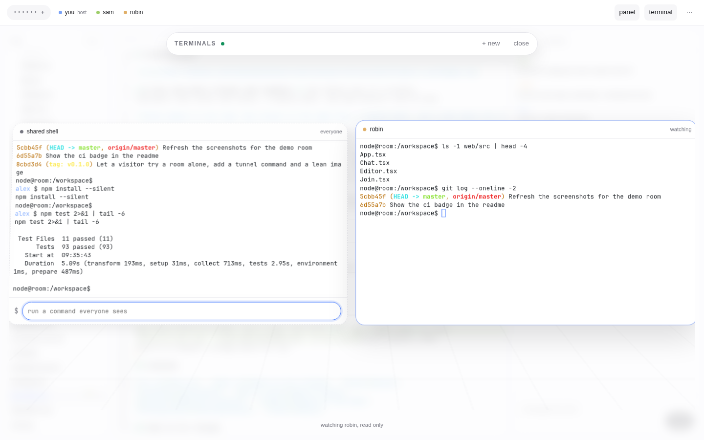

# climultiplayer

[](https://github.com/sjdsjadjajdjsa/climultiplayer/actions/workflows/ci.yml)
[](https://github.com/sjdsjadjajdjsa/climultiplayer/releases)
[](LICENSE)
[](package.json)

**A live room where friends code together.** One shared copy of a project,
everyone's own cursor and colour, a shared shell, and each person's own AI plan.


- **Together, for real.** Cursors, selections and the open file are shared live.
  Edits merge through a CRDT instead of fighting over one writer.
- **A shell nobody has to trust.** Guests type into a shared shell that runs in a
  throwaway container: read-only root, no capabilities, capped CPU, memory and
  PIDs. The workspace is a copy, so your folder is never touched.
- **Your plan, not the host's.** The assistant calls the subscription each person
  already pays for. No API keys, no shared quota.
- **Boring to set up.** One `npm start`, no account, nothing hosted for you.
  Invites are single use, expiring and revocable, and every join is your call.

## Quick start

You need Node.js 20 or newer, git, and Docker running (each room's shell runs in
a throwaway container).

```bash
git clone https://github.com/sjdsjadjajdjsa/climultiplayer
cd climultiplayer
npm install
npm run doctor       # checks your setup and tells you exactly what to fix
npm start
```

Open http://127.0.0.1:8787, type a name at the prompt, then type `demo` to look
around on your own. `start` makes an empty room and `start /path/to/folder` makes
one from a copy of a folder. Each command is also a button under the prompt.

The first room pulls the shell image (about 900 MB, once).

### Or run the prebuilt image

```bash
docker run -p 8787:8787 -v climpdata:/data \
  -v /var/run/docker.sock:/var/run/docker.sock \
  ghcr.io/sjdsjadjajdjsa/climultiplayer:latest
```

The socket mount is what lets the server start each room's shell container on
your Docker.

## Bring friends in

```bash
npm run tunnel   # a public link through a throwaway Cloudflare Tunnel
npm run host     # or: same WiFi, prints a LAN address to share
```

Start a room, click the room code at the top left to copy a single-use invite
link, and send it. Your friend opens it, types a name, and you allow or deny the
request. [Hosting](docs/hosting.md) covers tunnels, Tailscale and an always-on
server.

## What is in a room

| | |
|---|---|
| **Editor** | One file tree, live cursors and selections, follow a person with a click |
| **Shared shell** | One command line for the room; risky guest commands wait for the host |
| **Your own terminals** | Full TTYs in your own container and home, which the host can watch |
| **Assistant** | Runs on your ChatGPT, Claude, Grok or Copilot subscription, proposes edits as diffs |
| **Previews** | Share a dev server's port; everyone opens it as their own user |
| **Chat and publishing** | Room chat beside the code, and static sites served at `/p/<name>/` |



## If something goes wrong

| What you see | What to do |
|---|---|
| `docker: command not found`, or "docker is not running" | Install Docker, or start it, then run `npm run doctor` again |
| The landing page says the room image is missing | The first pull failed. Retry with `docker pull ghcr.io/sjdsjadjajdjsa/climultiplayer-room:latest`, or build it with `npm run room:image` |
| Installs in a room hang, or the image build stalls (often a VPN) | The docker bridge is blocked. Run `CLIMP_ROOM_NETWORK=host CLIMP_ALLOW_HOST_NETWORK=1 npm start`. Guests can then reach your machine's loopback, so only do this with people you trust |
| `address already in use` | Another copy is running. `PORT=8790 npm start`, or stop the other one |
| A blank page after rebuilding | Restart the server; it keeps serving the old asset names |
| No Docker at all | `CLIMP_SHELL=host npm start` runs the shell as you, and only the host can type in it |

## Documentation

| | |
|---|---|
| [Using a room](docs/guide.md) | plans, terminals, previews, publishing, roles |
| [Hosting](docs/hosting.md) | invites, tunnels, LAN, an always-on server |
| [Configuration](docs/configuration.md) | every environment variable, and the room images |
| [Security](SECURITY.md) | what a room can reach, what the gates are, and the limits |
| [Architecture](docs/architecture.md) | how the pieces fit |
| [Contributing](.github/CONTRIBUTING.md) | running it for development, tests, house style |

Changes are listed in the [releases](https://github.com/sjdsjadjajdjsa/climultiplayer/releases).

## License

[MIT](LICENSE)
