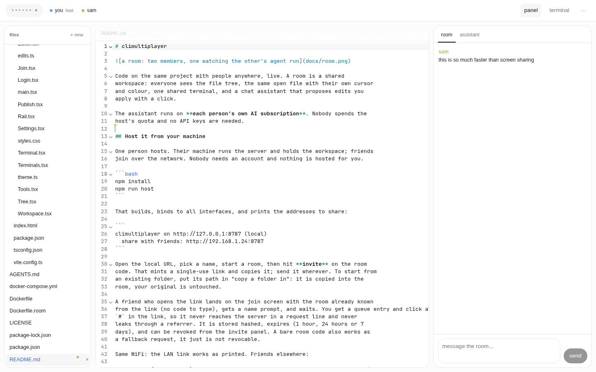

# climultiplayer



Code on the same project with people anywhere, live. A room is a shared
workspace: everyone sees the file tree, the same open file with their own cursor
and colour, one shared terminal, and a chat assistant that proposes edits you
apply with a click.

The assistant runs on **each person's own AI subscription**. Nobody spends the
host's quota and no API keys are needed.

## Host it from your machine

One person hosts. Their machine runs the server and holds the workspace; friends
join over the network. Nobody needs an account and nothing is hosted for you.

```bash
npm install
npm run host
```

That builds, binds to all interfaces, and prints the addresses to share:

```
climultiplayer on http://127.0.0.1:8787 (local)
  share with friends: http://192.168.1.24:8787
```

Open the local URL, pick a name, start a room, then hit **invite** on the room
code. That mints a single-use link and copies it; send it wherever. To start from
an existing folder, put its path in "copy a folder in": it is copied into the
room, your original is untouched. A small `.git` is copied out of a real
repository so `git status` and `git log` work in the room, but a history over
40 MB is skipped to keep the copy light.

A friend who opens the link lands on the join screen with the room already known
from the link (no code to type), gets a name prompt, and waits. You get a queue entry and click allow. The invite token sits after the
`#` in the link, so it never reaches the server in a request line and never
leaks through a referrer. It is stored hashed, expires (1 hour, 24 hours or 7
days), and can be revoked from the invite panel. A bare room code also works as
a fallback request, it just is not revocable.

Same WiFi: the LAN link works as printed. Friends elsewhere:

- **Tunnel (recommended).** Run the server bound to loopback and put a tunnel in
  front (Cloudflare Tunnel or equivalent). Your IP is not in any invite, your
  router needs no port forward, and you get TLS, which also switches the session
  cookie to `Secure`. Works from anywhere.
- **Tailscale.** Put both machines on it and share the Tailscale address. Fine
  for people you already trust; the address reveals your tailnet membership.

Direct `npm run host` with a home IP exposed is the fallback for a quick LAN
session, not the default advice for strangers.

The room lives as long as the host's process does, and the workspace is deleted
with the room. For an always-on room, run `docker compose up -d --build` on a
small server instead; the flow is identical, only the host is a box.

For development, `npm run dev` in one shell and `npm run dev --workspace web`
in another (the Vite server proxies to the API).

`npm start` builds first and stays bound to loopback; `npm run serve` skips the
build when you know `dist` is current. Pass `--lan` or set `HOST` to open it up.

## Plans

Click **plans** in the bar and connect a subscription you already pay for:
ChatGPT, Claude, Grok or GitHub Copilot. Sign-in uses the same public CLI client
each vendor's own tool uses, and tokens are stored per member on the server, in
`$CLIMP_DATA/auth/<member>.json` (mode 0600). Nothing is sent anywhere except to
the vendor you picked.

ChatGPT, Claude and Grok open a browser tab. When the app runs in Docker or on
another machine, the redirect lands on `127.0.0.1:1455`/`56121` inside the
container, which your browser cannot reach: copy the URL from the address bar
after the redirect fails and paste it into the plan's "or paste the redirected
URL" box. Copilot and Grok also offer a device code, which needs no callback.

## Settings

The `···` menu opens Settings (accounts, tools and keys). Everything else lives in
that same menu: invites, publish site, command log, download room, people, end
room, leave.

## Publishing a site

A host can publish the room's files at `/p/<name>/` on the same address, so a
tunnel exposes it with no account and no CORS. Files are copied to
`$CLIMP_DATA/pages`, and the panel links and deletes them.

## Harnesses

The room image ships the four plan-based CLIs. Anything else comes from
**Settings › tools**: Crush, OpenCode, Amp, Gemini CLI and Aider install into
*your* home (`~/.npm-global` or `~/.local`), so the shared image stays small and
you can add a tool without a rebuild. Only your own terminals see your installs.
Anything needing an API key reads it from `~/.env` in your home. 

## Room chat

The right rail has two tabs: **room**, a plain chat between everyone in the room,
and **assistant**, the AI. Room chat is the default tab.

## Presence

- The header lists who is here; hovering a name shows what they are doing, and
  clicking it follows them.
- Click a member to **follow** them: your view parks on their file and their
  terminal, so watching someone's agent run is one click.
- Remote carets carry the person's name and colour.
- Terminal tabs pulse when output arrives on a tab you are not looking at.

## Terminals

`terminal` summons a tilted stage of terminal cards. Two kinds:

- **Shared** (dashed card): one command line per room, everyone types, each
  command shows who ran it. Risky commands here are held for the host.
- **Per person**: `+ new` opens a full TTY card in the room container. You type,
  everyone else can click your card and watch live, read-only. This is where you
  run `claude`, `codex`, `grok` or `copilot`, which the room image ships.

Esc or `close` puts the stage away; the sessions keep running.

Each member gets a private home directory on the host (`rooms/<code>/homes/`),
so a CLI sign-in survives a reconnect and dies with the room. Nobody touches
your real home directory.

Approvals live on the shared line only: a full-screen TUI redraws constantly, so
gating keystrokes there is unreliable. Containerisation is the boundary for
personal terminals, and `trust` promotes someone so their shared commands stop
asking too.

## What a guest can do

Guests edit files and use the shared shell. Anything that looks dangerous
(`rm`, `git push`, pipes into a shell, installs, redirects, `sudo`, ...) is held
until the host clicks allow. The host runs risky commands directly.

## How it works

| Piece | What it is |
|---|---|
| `server/src/ws.ts` | y-websocket compatible sync per file, over `y-protocols`, with awareness for cursors |
| `server/src/docs.ts` | One CRDT document per open file, seeded from disk, persisted back after edits |
| `server/src/control.ts` | Room socket: presence, shared pty, approvals, chat, applying edits |
| `server/src/auth/` | Subscription sign-in and vendor wire adapters, ported from Prism |
| `web/` | React client: CodeMirror + `y-codemirror.next`, xterm, chat with diff cards |
| `server/src/rooms.ts` | Room codes, member tokens, the workspace copy per room |

File contents live in the CRDT only while a room is open and are written to
`$CLIMP_DATA/rooms/<code>/workspace` as they change. Rooms with no connections
are deleted after `CLIMP_ROOM_IDLE_MINUTES` (default 180).

## Security posture

- Sessions are an HttpOnly, SameSite=Strict cookie, `Secure` behind TLS. No token
  in localStorage, websocket URLs or logs.
- Invite tokens are single use, expiring, revocable, and hashed at rest.
- Joining is a host decision; a denied request does not spend the invite.
- Join attempts are limited to 20 per minute per address and room.
- Only the host and trusted editors can approve a held command, so a guest
  cannot wave their own `rm -rf` through.
- Shell input is rate limited to 8 commands per 5 seconds per member, and one
  assistant answer at a time, so nobody can bury the room or drain a plan.
- The host can remove anyone with the × on their name, end the room outright, and
  `trust` a guest into an editor role that skips risky-command approvals.
  A removed member needs a fresh invite to return.
- Every run, approval and denial is recorded in a host-only command log.
- The host can download the whole room as a `.tar.gz` at any time.
- Files stay inside the room workspace; traversal is refused on every path.
- The room shell runs in a throwaway container: only the workspace is mounted,
  capabilities are dropped, `no-new-privileges` is set, and memory, CPU and PID
  count are capped. Your home directory, the data dir and the docker socket stay
  outside it.
- Guests still ask before risky commands; editing is never gated, promotion is
  explicit, and every command lands in the log.
- The container root filesystem is read-only. `/tmp` is a small tmpfs, the
  workspace and each member's home stay writable, and global installs are
  pointed at the member home, so `npm i -g` still works.

Docker is required for the container shell. Without it the server falls back to
a shell on the host (it says which at startup), and `CLIMP_SHELL=host` forces
the fallback. Build the image once after installing:

```bash
npm run room:image
```

If the daemon's bridge network hangs on apt (index lookups time out), build and
run with host networking: `docker build --network host -f Dockerfile.room -t
climultiplayer-room .` and `CLIMP_ROOM_NETWORK=host`.

`CLIMP_ROOM_NETWORK=none` cuts the container off from the network entirely
(no `npm install`, no `git fetch`).

## Limits of the base

- The shared line-based shell is where approvals work; personal terminals are
  full TTYs and are not command-gated.
- Approvals are a regex heuristic, not a sandbox. Inline code, script files and
  `xargs` are matched, but a determined guest can still rewrite the workspace
  copy, and a host-mode shell can reach your home directory.
- One shell per room, shared by everyone.
- Text only. Binary files can be opened but are read as UTF-8.
- Anyone with an open invite can request in, and the host must approve.
- Container network access is on by default so installs work; turn it off per
  deployment if you would rather fetch nothing.
- Rooms on the same server share the docker daemon, so a container escape is a
  daemon-level problem, not a per-room one.
- No git integration yet, and no per-file locks; concurrent edits merge through
  the CRDT rather than through patch review.

## Configuration

| Variable | Default | Meaning |
|---|---|---|
| `PORT` | `8787` | listen port |
| `HOST` | `127.0.0.1`, or `0.0.0.0` with `--lan` / `npm run host` | bind address |
| `CLIMP_DATA` | `~/.local/share/climultiplayer` | rooms, workspaces, tokens |
| `CLIMP_ROOM_IDLE_MINUTES` | `180` | delete rooms idle this long |
| `CLIMP_MAX_FILE` | `2097152` | largest editable file in bytes |
| `CLIMP_SHELL` | `auto` | `docker` (contained), `host`, or `auto` |
| `CLIMP_ROOM_IMAGE` | `climultiplayer-room:latest` | image the room shell runs |
| `CLIMP_ROOM_MEMORY` | `1g` | memory cap per room |
| `CLIMP_ROOM_CPUS` | `1` | CPU cap per room |
| `CLIMP_ROOM_NETWORK` | `bridge` | `none` for an offline room, `host` if the bridge is broken |
| `CLIMP_WEB` | `web/dist` | built client directory |

## Tests

```bash
npm test          # server, rooms, invites, auth, sync, containment
npm run test:ui   # real Chromium: two browsers through the whole join and edit path
npm run test:audit # real Chromium: opens every panel and control, fails on any dead end
```

`test:ui` needs a Chromium binary (set `CHROME_BIN` if it is not at
`/usr/bin/chromium`). It starts its own server on a random port and cleans up.
It runs against host shells by default; `CLIMP_SHELL=docker
CLIMP_ROOM_NETWORK=host npm run test:ui` exercises the container path, including
a member terminal and home persistence.

## License

MIT. See [LICENSE](LICENSE).
