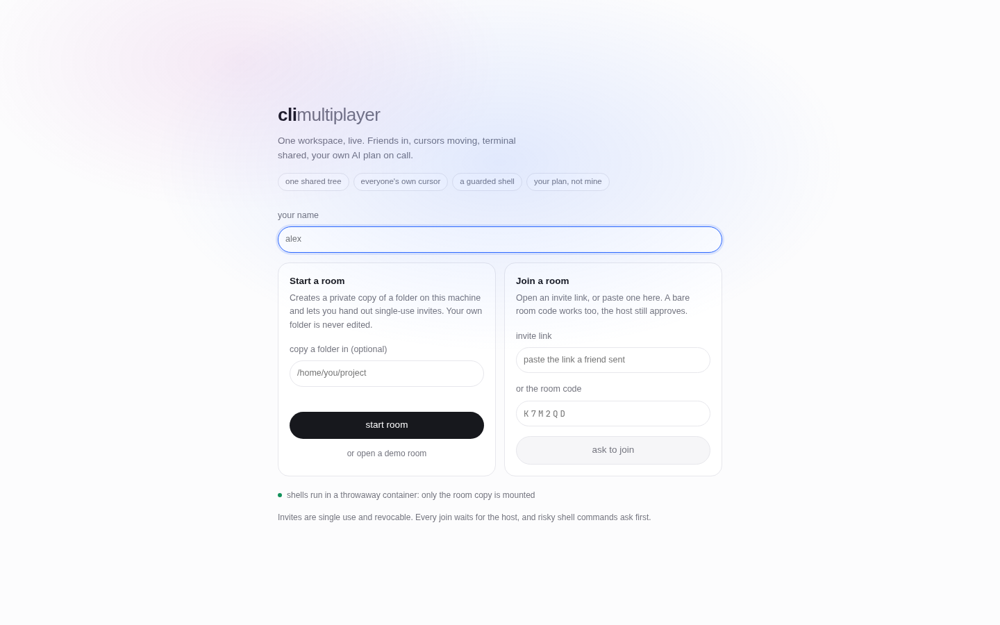
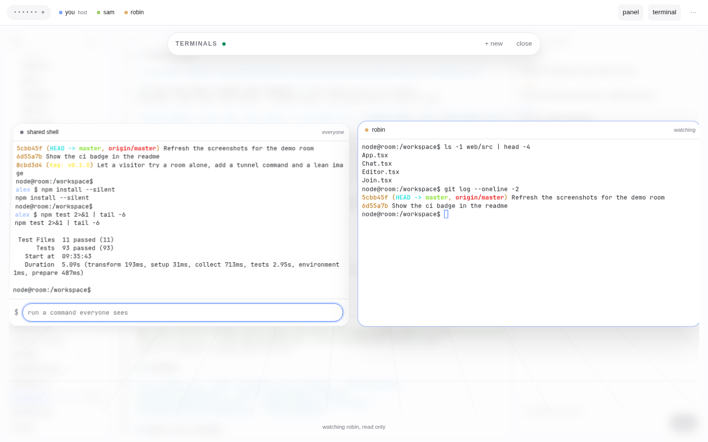
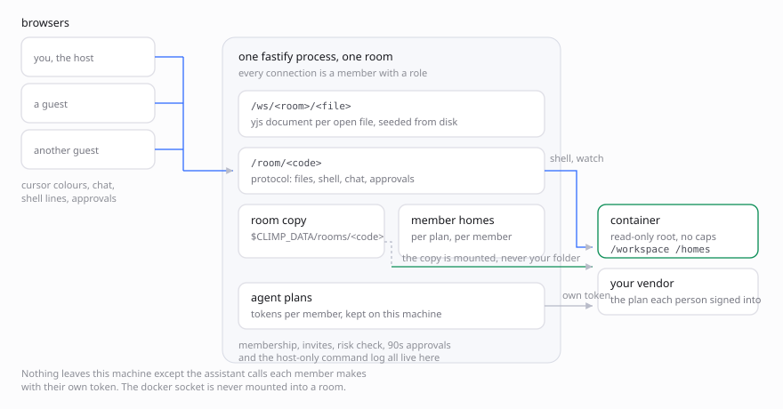
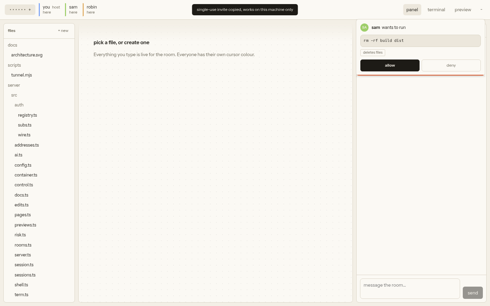

# climultiplayer

[](https://github.com/sjdsjadjajdjsa/climultiplayer/actions/workflows/ci.yml)
[](LICENSE)
[](package.json)
[](SECURITY.md)

**A live room where friends code together.** One shared copy of a project,
everyone's own cursor and colour, a shared shell, and each person's own AI plan.


- **Together, for real.** Cursors, selections and the open file are shared live.
  Edits merge through a CRDT instead of fighting over one writer.
- **A shell nobody has to trust.** Guests type into a shared shell that runs in a
  throwaway container: read-only root, no capabilities, capped CPU, memory and
  PIDs. The workspace is a copy, so your folder is never touched.
- **Your plan, not the host's.** The assistant calls the subscription each person
  already pays for. No API keys, no shared quota.
- **Boring to set up.** One `npm start`, no account, nothing hosted for you.
  Invites are single use, expiring and revocable, and every join is your call.

## Try it

Needs Node 20+ and Docker.

```bash
git clone https://github.com/sjdsjadjajdjsa/climultiplayer
cd climultiplayer
npm install
npm run room:image
CLIMP_ROOM_NETWORK=host CLIMP_ALLOW_HOST_NETWORK=1 npm start
```

Open http://127.0.0.1:8787, type a name at the prompt, then `demo` to look around
on your own (or `start`, or click the word under the prompt). Host networking is the sane default behind a VPN, but it
hands guests your loopback, so it needs the second flag; drop both if docker's
bridge works for you.

## Contents

[Try it](#try-it) · [Host it](#host-it-for-friends) · [Plans](#plans) ·
[Terminals](#terminals) · [Previews](#previews) · [How it works](#how-it-works) ·
[Security](#security-posture) · [Limits](#limits-of-the-base) ·
[Configuration](#configuration) · [Tests](#tests)

## Host it for friends

One person hosts. Their machine runs the server and holds the workspace; friends
join over the network. Nobody needs an account and nothing is hosted for you.

One command past the steps above:

```bash
npm run host
```

That builds, binds to all interfaces, and prints the addresses to share:

```
climultiplayer on http://127.0.0.1:8787 (local)
  share with friends: http://192.168.1.24:8787
```

Open the local URL, pick a name, start a room, then hit **invite** on the room
code. That mints a single-use link and copies it; send it wherever. To start from
an existing folder, put its path in "copy a folder in": it is copied into the
room, your original is untouched. A small `.git` is copied out of a real
repository so `git status` and `git log` work in the room, but a history over
40 MB is skipped to keep the copy light.

No friend around? `demo` drops a small project in the room so you can try cursors,
the shell and the assistant on your own. The landing page takes `start [folder]`,
`join <link or code>`, `demo`, `help`, `clear` and `cancel`, and each has a button.



A friend who opens the link lands on the same terminal, with the room already
known from the link (no code to type). They type a name, press enter to use the
invite, and wait. Their request
arrives as a card you allow or deny. The invite token sits after the
`#` in the link, so it never reaches the server in a request line and never
leaks through a referrer. It is stored hashed, expires (1 hour, 24 hours or 7
days), and can be revoked from the invite panel. A bare room code also works as
a fallback request, it just is not revocable.

Same WiFi: the LAN link works as printed. Friends elsewhere:

- **Tunnel (recommended).** `npm run tunnel` builds, binds to loopback, and puts
  a throwaway Cloudflare Tunnel in front of it, printing a public link. Your IP
  is not in any invite, your router needs no port forward, and you get TLS, which
  also switches the session cookie to `Secure`. Works from anywhere. Needs
  [cloudflared](https://developers.cloudflare.com/cloudflare-one/connections/connect-networks/downloads/)
  on PATH.
- **Tailscale.** Put both machines on it and share the Tailscale address. Fine
  for people you already trust; the address reveals your tailnet membership.

Direct `npm run host` with a home IP exposed is the fallback for a quick LAN
session, not the default advice for strangers.

The room lives as long as the host's process does, and the workspace is deleted
with the room. For an always-on room, run `docker compose up -d --build` on a
small server instead; the flow is identical, only the host is a box.

For development, `npm run dev` in one shell and `npm run dev --workspace web`
in another (the Vite server proxies to the API).

`npm start` builds first and stays bound to loopback; `npm run serve` skips the
build when you know `dist` is current. Pass `--lan` or set `HOST` to open it up.

## Plans

Click **plans** in the bar and connect a subscription you already pay for:
ChatGPT, Claude, Grok or GitHub Copilot. Sign-in uses the same public CLI client
each vendor's own tool uses, and tokens are stored per member on the server, in
`$CLIMP_DATA/auth/<member>.json` (mode 0600). Nothing is sent anywhere except to
the vendor you picked.

ChatGPT, Claude and Grok open a browser tab. When the app runs in Docker or on
another machine, the redirect lands on `127.0.0.1:1455`/`56121` inside the
container, which your browser cannot reach: copy the URL from the address bar
after the redirect fails and paste it into the plan's "or paste the redirected
URL" box. Copilot and Grok also offer a device code, which needs no callback.

## Settings

The `···` menu opens Settings (accounts, tools and keys). Everything else lives in
that same menu: invites, publish site, command log, download room, people, end
room, leave.

## Publishing a site

A host can publish the room's files at `/p/<name>/` on the same address, so a
tunnel exposes it with no account and no CORS. Files are copied to
`$CLIMP_DATA/pages`, without `node_modules`, `.git`, `.env*` or symlinks, and the
panel links and deletes them. Pages are served with `Content-Security-Policy:
sandbox`, so their scripts get an opaque origin and cannot call the API as
whoever opened them. A path may not walk above its own site folder.

## Harnesses

The lean room image ships no agent CLIs; the full image bakes Claude Code,
Codex, Grok and Copilot. Everything is also on offer in **Settings › tools**,
which installs into *your* home (`~/.npm-global` or `~/.local`) rather than the
shared image, so a lean room can still get any of them. The catalogue is Claude
Code, Codex, Grok, Copilot, Crush, OpenCode, Amp, Gemini CLI and Aider. Only your
own terminals see your installs, and anything needing an API key reads it from
`~/.env` in your home.

## Room chat

The right rail has two tabs: **room**, a plain chat between everyone in the room,
and **assistant**, the AI. Room chat is the default tab.

## Presence

- The header lists who is here; hovering a name shows what they are doing, and
  clicking it follows them.
- Click a member to **follow** them: your view parks on their file and their
  terminal, so watching someone's agent run is one click.
- Remote carets carry the person's name and colour.
- Terminal tabs pulse when output arrives on a tab you are not looking at.

## Terminals



`terminal` summons a tilted stage of terminal cards. Two kinds:

- **Shared** (dashed card): one command line per room, everyone types, each
  command shows who ran it. Risky commands here are held for the host.
- **Per person**: `+ new` opens a full TTY card in your own container (same
  workspace, your own home). You type; the host can click your card and watch
  live, read-only. This is where you
  run `claude`, `codex`, `grok` or `copilot` from the full room image.

Esc or `close` puts the stage away; the sessions keep running.

Each member gets a private home directory on the host (`rooms/<code>/homes/`),
so a CLI sign-in survives a reconnect and dies with the room. Nobody touches
your real home directory.

Approvals live on the shared line only: a full-screen TUI redraws constantly, so
gating keystrokes there is unreliable. Containerisation is the boundary for
personal terminals, and `trust` promotes someone so their shared commands stop
asking too.

## Previews

Run a dev server in your terminal, listening on all addresses
(`npm run dev -- --host 0.0.0.0` for Vite), then hit **preview** and share its
port. Everyone in the room gets a toast and can open it. Each browser signs in
to the preview on its own, so two people are two users of the app at once: one
logs in as the admin, the other as a customer, and you watch each other's
changes land. **link for a second user** copies a fresh sign-in link; paste it in
a private window to be both users yourself.

- The ports a preview may use are `CLIMP_PREVIEW_PORTS` (default
  `3000,4173,5000,5173,8000,8080`). With bridge networking docker publishes them
  on the host's loopback only, so the gateway is the only way in. With host
  networking they are simply the host's own ports, so two rooms cannot preview
  the same port at once.
- Previews are served by a gateway on `CLIMP_PREVIEW_PORT` (default the app port
  plus one). It is a separate origin from the room app, so the previewed code
  never runs where your room session lives, and the room cookie is stripped
  before anything reaches the dev server.
- Getting in takes a single-use link minted by the room for a member, good for
  two minutes. Every request after that checks the member is still in the room
  and the preview is still live. Removing someone shuts them out at once.
- A preview stops when its owner or the host stops it, after
  `CLIMP_PREVIEW_HOURS` (default 3), or when the room ends.
- The server refuses a preview whose port nothing answers on, and says to bind
  the dev server to `0.0.0.0`. A server on `127.0.0.1` inside the container is
  not reachable from the host.
- `npm run tunnel` opens a second tunnel for previews. Previews need docker with
  bridge networking; with `docker compose` the server cannot reach the host's
  loopback, so previews are off there for now.

## What a guest can do

Rooms only start from the host machine itself; a guest arriving through a tunnel
asks for an invite instead. `CLIMP_OPEN_ROOMS=1` lets anyone start one.

Guests edit files and use the shared shell. Without docker the shell is the host
user's own, so only the host can type in it and only the host gets terminals;
with the container, guests get both, each in their own home. Anything that looks dangerous
(`rm`, `git push`, pipes into a shell, installs, redirects, `sudo`, ...) is held
until the host clicks allow. The host runs risky commands directly.

## How it works



| Piece | What it is |
|---|---|
| `server/src/ws.ts` | y-websocket compatible sync per file, over `y-protocols`, with awareness for cursors |
| `server/src/docs.ts` | One CRDT document per open file, seeded from disk, persisted back after edits |
| `server/src/control.ts` | Room socket: presence, shared pty, approvals, chat, applying edits |
| `server/src/auth/` | Subscription sign-in and vendor wire adapters, ported from Prism |
| `web/` | React client: CodeMirror + `y-codemirror.next`, xterm, chat with diff cards |
| `server/src/rooms.ts` | Room codes, member tokens, the workspace copy per room |

File contents live in the CRDT only while a room is open and are written to
`$CLIMP_DATA/rooms/<code>/workspace` as they change. Rooms with no connections
are deleted after `CLIMP_ROOM_IDLE_MINUTES` (default 180).

## Security posture

- Sessions are an HttpOnly, SameSite=Strict cookie, `Secure` behind TLS. No token
  in localStorage, websocket URLs or logs.
- Invite tokens are single use, expiring, revocable, and hashed at rest.
- Joining is a host decision; a denied request does not spend the invite.
- Join attempts are limited to 20 per minute per address and room.
- Only the host and trusted editors can approve a held command, so a guest
  cannot wave their own `rm -rf` through.
- Shell input is rate limited to 8 commands per 5 seconds per member, and one
  assistant answer at a time, so nobody can bury the room or drain a plan.

- The host can remove anyone with the × on their name, end the room outright, and
  `trust` a guest into an editor role that skips risky-command approvals.
  A removed member needs a fresh invite to return.
- Every run, approval and denial is recorded in a host-only command log.
- The host can download the whole room as a `.tar.gz` at any time, without
  `.git`: hooks and `core.fsmonitor` in a guest-made repository would run on your
  machine.
- Files stay inside the room workspace; traversal is refused on every path.
- The room shell runs in a throwaway container: only the workspace is mounted,
  capabilities are dropped, `no-new-privileges` is set, and memory, CPU and PID
  count are capped. Your home directory, the data dir and the docker socket stay
  outside it.
- Each member's terminals and tool installs get their own container, mounting
  only that member's own home, so a sign-in token in `/homes/<them>` is not
  readable from someone else's shell. Only the owner and the host can watch a
  personal terminal.
- Plan tokens live in `$CLIMP_DATA/auth`, owner-only (`0700` folder, `0600`
  files), and are deleted when the member is removed, leaves, or the room ends.
- Symlinks made in the room are refused by the file API rather than followed on
  the host, so `ln -s ~/.ssh/id_ed25519 key` cannot read your keys.
- Cross-site requests and websocket upgrades need a matching `Origin`, and rooms
  cannot be started from off the machine by default.
- Guests still ask before risky commands; editing is never gated, promotion is
  explicit, and every command lands in the log.
- The container root filesystem is read-only. `/tmp` is a small tmpfs, the
  workspace and each member's home stay writable, and global installs are
  pointed at the member home, so `npm i -g` still works.



Docker is required for the container shell. Without it the server falls back to
a shell on the host (it says which at startup), and `CLIMP_SHELL=host` forces
the fallback. Build the image once after installing:

```bash
npm run room:image
```

That image is deliberately lean (about 870 MB): git, curl, an editor, a
compiler. If people should drive their own agent inside the room, add the CLIs
on top with `npm run room:image:full` and set
`CLIMP_ROOM_IMAGE=climultiplayer-room:full`; that image is several gigabytes
because it bundles four agent harnesses.

If the daemon's bridge network hangs on apt (index lookups time out), build and
run with host networking: `docker build --network host -f Dockerfile.room -t
climultiplayer-room .` and `CLIMP_ROOM_NETWORK=host`.

`CLIMP_ROOM_NETWORK=none` cuts the container off from the network entirely
(no `npm install`, no `git fetch`).

## Limits of the base

- The shared line-based shell is where approvals work; personal terminals are
  full TTYs and are not command-gated.
- Approvals are a regex heuristic, not a sandbox. Inline code, script files and
  `xargs` are matched, but a determined guest can still rewrite the workspace
  copy, and a host-mode shell can reach your home directory.
- One shell per room, shared by everyone.
- Text only. Binary files can be opened but are read as UTF-8.
- Anyone with an open invite can request in, and the host must approve.
- Container network access is on by default so installs work; turn it off per
  deployment if you would rather fetch nothing.
- Rooms on the same server share the docker daemon, so a container escape is a
  daemon-level problem, not a per-room one.
- No git integration yet, and no per-file locks; concurrent edits merge through
  the CRDT rather than through patch review.

## Configuration

| Variable | Default | Meaning |
|---|---|---|
| `PORT` | `8787` | listen port |
| `HOST` | `127.0.0.1`, or `0.0.0.0` with `--lan` / `npm run host` | bind address |
| `CLIMP_DATA` | `~/.local/share/climultiplayer` | rooms, workspaces, tokens |
| `CLIMP_ROOM_IDLE_MINUTES` | `180` | delete rooms idle this long |
| `CLIMP_MAX_FILE` | `2097152` | largest editable file in bytes |
| `CLIMP_SHELL` | `auto` | `docker` (contained), `host`, or `auto` |
| `CLIMP_ROOM_IMAGE` | `climultiplayer-room:latest` | image the room shell runs; `climultiplayer-room:full` adds agent CLIs |
| `CLIMP_ROOM_MEMORY` | `1g` | memory cap per room |
| `CLIMP_ROOM_CPUS` | `1` | CPU cap per room |
| `CLIMP_ROOM_NETWORK` | `bridge` | `none` for an offline room, `host` if the bridge is broken |
| `CLIMP_ALLOW_HOST_NETWORK` | unset | `1` to use `host` networking, which exposes your loopback to guests |
| `CLIMP_TRUST_PROXY` | unset | `1` to trust forwarding headers from your tunnel, for join rate limits |
| `CLIMP_ORIGINS` | unset | extra comma separated hosts allowed to call the API |
| `CLIMP_OPEN_ROOMS` | unset | `1` to let anyone, not only this machine, start a room |
| `CLIMP_WEB` | `web/dist` | built client directory |

## Tests

```bash
npm test          # server, rooms, invites, auth, sync, containment
npm run test:ui   # real Chromium: two browsers through the whole join and edit path
npm run test:audit # real Chromium: opens every panel and control, fails on any dead end
```

`docs:shots` rewrites the screenshots and `docs:gif` re-records the clip at the
top; both drive a real browser, and the GIF needs `ffmpeg` and ImageMagick.

`test:ui` needs a Chromium binary (set `CHROME_BIN` if it is not at
`/usr/bin/chromium`). It starts its own server on a random port and cleans up.
It runs against host shells by default; `CLIMP_SHELL=docker
CLIMP_ROOM_NETWORK=host npm run test:ui` exercises the container path, including
a member terminal and home persistence.

## License

MIT. See [LICENSE](LICENSE).

---

[Contributing](CONTRIBUTING.md) · [Security and threat model](SECURITY.md) ·
[Code of conduct](CODE_OF_CONDUCT.md) · [How the pieces fit](AGENTS.md) ·
[Changelog/releases](https://github.com/sjdsjadjajdjsa/climultiplayer/releases)
