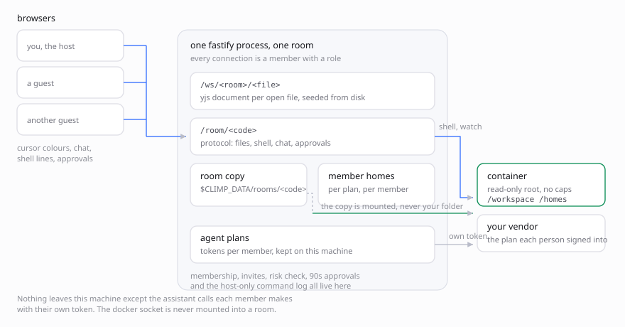

# Architecture

One Node process holds every room. Browsers talk to it over two kinds of
websocket, the workspace copy and member homes sit on its disk, and shells run
in containers beside it.



## The two sockets

- **File sync** (`server/src/ws.ts`). One y-websocket compatible connection per
  open file, carrying CRDT updates and awareness (cursors, selections, names).
- **Control** (`server/src/control.ts`). One connection per member for
  everything else: presence, the shared shell, approvals, chat, terminals,
  previews and applying assistant edits.

## A file's life

`createRoom` copies the host's folder into
`$CLIMP_DATA/rooms/<code>/workspace`, leaving `node_modules`, build output and
caches behind. Nothing is ever written back to the original.

When someone opens a file, `docs.ts` seeds a Yjs document from disk. From then
on the document is the truth: edits from every browser merge in it, and changes
are written back to the workspace copy in batches so the shell sees them. The
document goes away when the room does.

## Shells

`container.ts` decides between two modes. With docker, the room gets one
container for the shared shell and one per member for their own terminals and
tool installs. Members share the workspace and never a home, because a home
holds CLI sign-ins. Without docker the shell is a login shell as the server
user, and only the host may use it.

The shared shell is line based, which is what makes approvals possible:
`risk.ts` matches each guest command against a list of risky shapes and holds
it until the host or an editor answers. Personal terminals (`sessions.ts`) are
raw TTYs and are not gated.

## Server modules

| File | Role |
|---|---|
| `server.ts` | HTTP routes, static web, startup, room teardown |
| `control.ts` | the control socket: roles, approvals, chat, presence |
| `ws.ts` | per-file CRDT sync and awareness |
| `docs.ts` | Yjs documents per room file, batched writes to disk |
| `rooms.ts` | room codes, members, invites, workspace seeding |
| `workspace.ts` | path containment, symlink refusal, file IO |
| `container.ts` | docker run flags, images, per-member homes |
| `shell.ts`, `term.ts` | the shared shell |
| `sessions.ts` | personal terminals and watching them |
| `risk.ts` | the risky-command patterns |
| `previews.ts` | the preview gateway, tickets and membership checks |
| `pages.ts` | published static sites under `/p/<name>/` |
| `ai.ts`, `edits.ts` | assistant replies on a member's plan, and their edit blocks |
| `auth/` | subscription sign-in and vendor wire adapters |
| `tools.ts` | the agent CLI catalogue installed into member homes |
| `session.ts` | the `climp` session cookie |

## Web client

`web/` is React and Vite. `Workspace.tsx` is the room and owns the control
socket; `Editor.tsx` is CodeMirror with `y-codemirror.next`; `Terminals.tsx`
and `Terminal.tsx` are xterm; `Chat.tsx` renders assistant answers with diff
cards; `Join.tsx` is the terminal-style landing page.

## Where things live on disk

```
$CLIMP_DATA/
  rooms/<code>/workspace/   the room's copy of the project
  rooms/<code>/homes/<id>/  each member's $HOME inside their container
  auth/<member>.json        plan tokens, owner-only
  pages/<name>/             published sites
```

A room is deleted by its host or by the idle sweep. Both go through
`teardownRoom` in `server.ts`, which closes previews, sockets, terminals and
documents before removing the folder and its containers.

`AGENTS.md` at the repository root lists the traps worth knowing before
changing behaviour.
