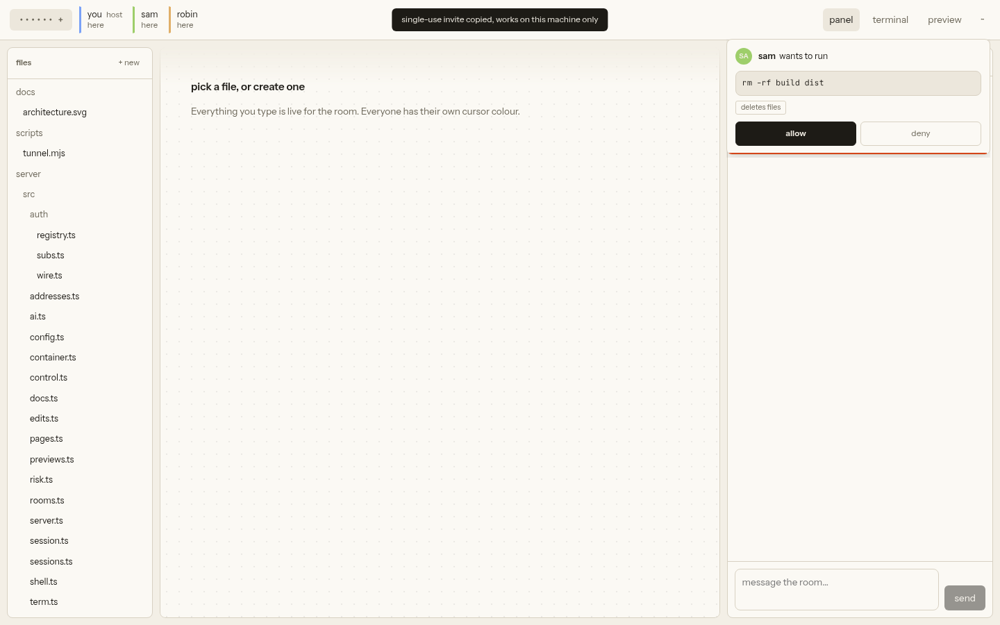
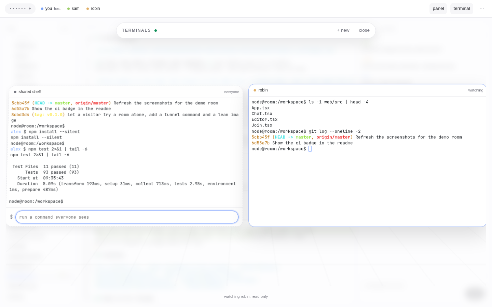

# Using a room

[The menu](#the-menu) · [Roles](#roles) · [Presence](#presence) ·
[Terminals](#terminals) · [Plans](#plans) · [Agent CLIs](#agent-clis) ·
[Previews](#previews) · [Publishing a site](#publishing-a-site)

## The menu

The `···` menu at the top right holds everything that is not the editor:
settings (accounts, tools and keys), invites, publish site, command log,
download room, people, end room and leave.

The right rail has two tabs: **room**, a plain chat between everyone in the
room, and **assistant**, the AI. Room chat is the default.

## Roles

| Role | Shared shell | Files | Can approve |
|---|---|---|---|
| Host | runs anything | edits | yes |
| Editor | runs anything | edits | yes |
| Guest | risky commands wait for approval | edits | no |

Anything that looks dangerous from a guest (`rm`, `git push`, pipes into a
shell, installs, redirects, `sudo` and so on) is held until the host or an
editor clicks allow. `trust` promotes a guest to editor. Editing files is never
gated, at any role.

The host can remove anyone with the × on their name, and a removed member needs
a fresh invite to return. Every run, approval and denial lands in a host-only
command log. The host can also download the whole room as a `.tar.gz` at any
time.

Without docker the shell is the host user's own, so only the host can type in
it and only the host gets terminals.

## Presence

- The header lists who is here. Hovering a name shows what they are doing.
- Click a member to **follow** them: your view parks on their file and their
  terminal, so watching someone's agent run is one click.
- Remote carets carry the person's name and colour.
- Terminal tabs mark output that arrives on a tab you are not looking at.

## Terminals

`terminal` opens a stage of terminal cards. There are two kinds:

- **Shared** (dashed card): one command line per room. Everyone types, and each
  command shows who ran it. Risky commands here are held for the host.
- **Per person**: `+ new` opens a full TTY card in your own container, with the
  same workspace and your own home. You type; the host can click your card and
  watch live, read-only.

Esc or `close` puts the stage away; the sessions keep running.

Each member gets a private home directory (`rooms/<code>/homes/` in the data
folder), so a CLI sign-in survives a reconnect and dies with the room. Nobody
touches your real home directory.

Approvals live on the shared line only. A full-screen TUI redraws constantly, so
gating keystrokes there is unreliable; the container is the boundary for
personal terminals.

## Plans

Open **Settings** in the `···` menu and connect a subscription you already pay
for: ChatGPT, Claude, Grok or GitHub Copilot. Sign-in uses the same public CLI
client each vendor's own tool uses. Tokens are stored per member on the server,
in `$CLIMP_DATA/auth/<member>.json` (mode 0600), and nothing is sent anywhere
except to the vendor you picked.

ChatGPT, Claude and Grok open a browser tab. When the server runs in Docker or
on another machine, the redirect lands on a `127.0.0.1` address your browser
cannot reach: copy the URL from the address bar after the redirect fails and
paste it into the plan's "or paste the redirected URL" box. Copilot and Grok
also offer a device code, which needs no callback.

## Agent CLIs

The default room image ships no agent CLIs. **Settings › tools** installs them
into *your* home (`~/.npm-global` or `~/.local`) rather than the shared image:
Claude Code, Codex, Grok, Copilot, Crush, OpenCode, Amp, Gemini CLI and Aider.
Only your own terminals see your installs, and anything needing an API key
reads it from `~/.env` in your home.

A host who wants them preinstalled for everyone can use the
[full room image](configuration.md#room-images).

## Previews

Run a dev server in your terminal, listening on all addresses
(`npm run dev -- --host 0.0.0.0` for Vite), then hit **preview** and share its
port. Everyone in the room gets a toast and can open it.

Each browser signs in to the preview on its own, so two people are two users of
the app at once: one logs in as the admin, the other as a customer, and you
watch each other's changes land. **link for a second user** copies a fresh
sign-in link; paste it in a private window to be both users yourself.

- A preview may use the ports in `CLIMP_PREVIEW_PORTS` (default
  `3000,4173,5000,5173,8000,8080`).
- The server refuses a preview whose port nothing answers on. A dev server
  bound to `127.0.0.1` inside the container is not reachable; bind to `0.0.0.0`.
- A preview stops when its owner or the host stops it, after
  `CLIMP_PREVIEW_HOURS` (default 3), or when the room ends.
- Removing someone from the room shuts them out of its previews at once.
- Previews need docker with bridge networking. They are off when the server
  itself runs in a container, and under host networking two rooms cannot
  preview the same port.

How previews are kept away from your room session is in
[SECURITY.md](../SECURITY.md#previews).

## Publishing a site

A host can publish the room's files at `/p/<name>/` on the same address, so a
tunnel exposes it with no account and no CORS. Files are copied to
`$CLIMP_DATA/pages`, without `node_modules`, `.git`, `.env*` or symlinks, and
the publish panel links and deletes them. Published pages are sandboxed, so
their scripts cannot call the room API as whoever opened them.
