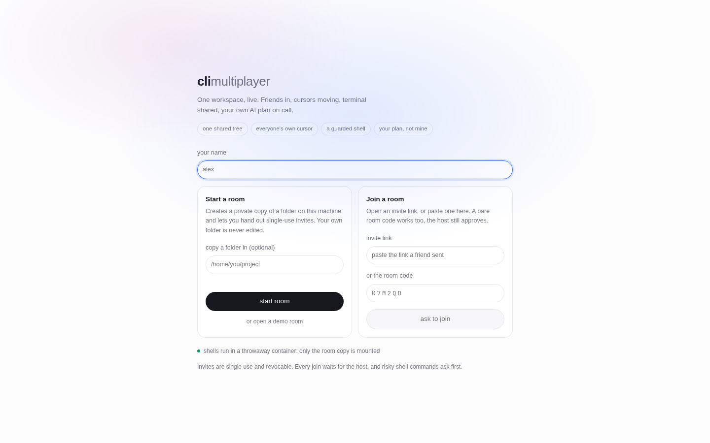

# Hosting

One person hosts. Their machine runs the server and holds the workspace; friends
join over the network. Nobody needs an account and nothing is hosted for you.

## Start a room and invite someone

Open the local URL, type a name and `start` (or `start /path/to/folder` to begin
from a copy of a folder), then click the room code at the top left. That mints a
single-use invite link and copies it; send it wherever.

The folder is copied into the room and your original is untouched. A small
`.git` is copied out of a real repository so `git status` and `git log` work in
the room, but a history over 40 MB is skipped to keep the copy light.

No friend around? `demo` drops a small project in the room so you can try
cursors, the shell and the assistant on your own. The landing page takes
`start [folder]`, `join <link or code>`, `demo`, `help`, `clear` and `cancel`,
and each has a button.



A friend who opens the link lands on the same terminal, with the room already
known from the link. They type a name, press enter to use the invite, and wait.
Their request arrives as a card you allow or deny.

The invite token sits after the `#` in the link, so it never reaches the server
in a request line and never leaks through a referrer. It is stored hashed,
expires (1 hour, 24 hours or 7 days), and can be revoked from the invite panel.
A bare room code also works as a fallback request; it just is not revocable.

## Reaching friends

| Command | Binds to | Use it for |
|---|---|---|
| `npm start` | loopback | trying it alone; builds first |
| `npm run tunnel` | loopback, behind a tunnel | friends anywhere (recommended) |
| `npm run host` | all interfaces | friends on the same WiFi |
| `npm run serve` | loopback | like `start` without the build; add `--lan` or set `HOST` to open it up |

- **Tunnel.** `npm run tunnel` puts a throwaway Cloudflare Tunnel in front of
  the server and prints a public link. Your IP is not in any invite, your router
  needs no port forward, and you get TLS, which also switches the session cookie
  to `Secure`. It needs
  [cloudflared](https://developers.cloudflare.com/cloudflare-one/connections/connect-networks/downloads/)
  on PATH. A second tunnel is opened for [previews](guide.md#previews).
- **Same WiFi.** `npm run host` prints the addresses to share:

  ```
  climultiplayer on http://127.0.0.1:8787 (local)
    share with friends: http://192.168.1.24:8787
  ```

  Exposing a home IP this way is for a quick LAN session, not for strangers.
- **Tailscale.** Put both machines on it and share the Tailscale address. Fine
  for people you already trust; the address reveals your tailnet membership.

## An always-on room

The room lives as long as the host's process does, and the workspace is deleted
with the room. For a room that stays up, run it on a small server:

```bash
docker compose up -d --build
```

or use the prebuilt image:

```bash
docker run -d -p 8787:8787 -v climpdata:/data \
  -v /var/run/docker.sock:/var/run/docker.sock \
  ghcr.io/sjdsjadjajdjsa/climultiplayer:latest
```

The flow is identical; only the host is a box. Two things differ when the server
itself runs in a container:

- Previews are off, because the server cannot reach the host's loopback where
  docker publishes the preview ports.
- Plan sign-in redirects land on `127.0.0.1` inside the container. See
  [Plans](guide.md#plans) for the paste-the-URL way around it.

Rooms with no connections are deleted after `CLIMP_ROOM_IDLE_MINUTES` (default
180). Rooms can only be started from the host machine unless
`CLIMP_OPEN_ROOMS=1` is set; see [Configuration](configuration.md).
